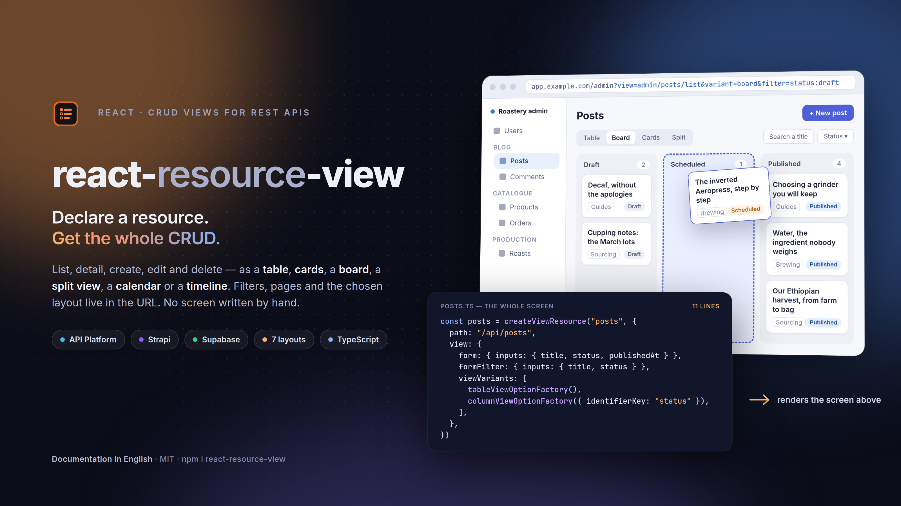
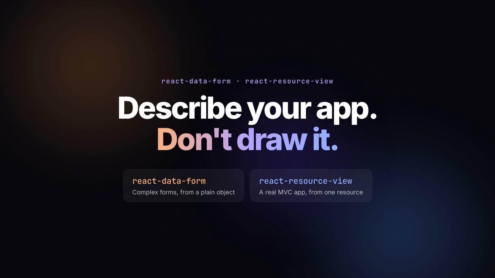
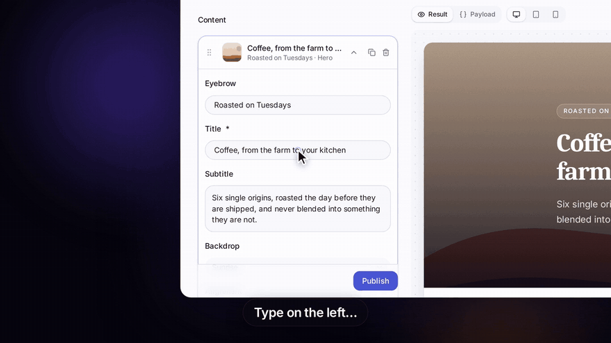
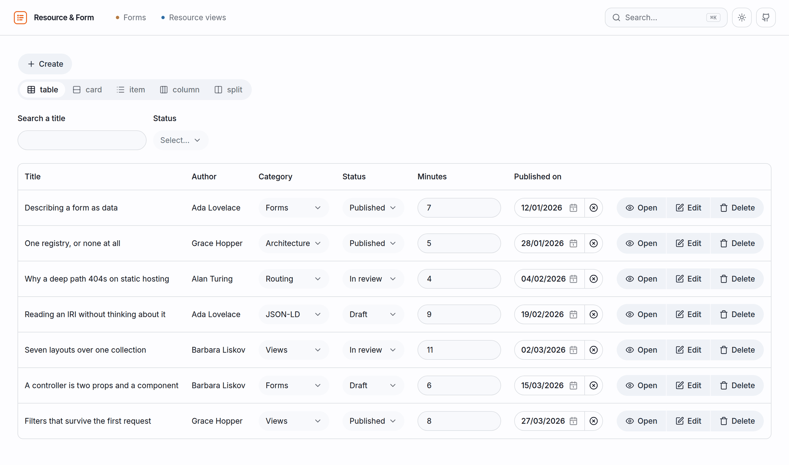
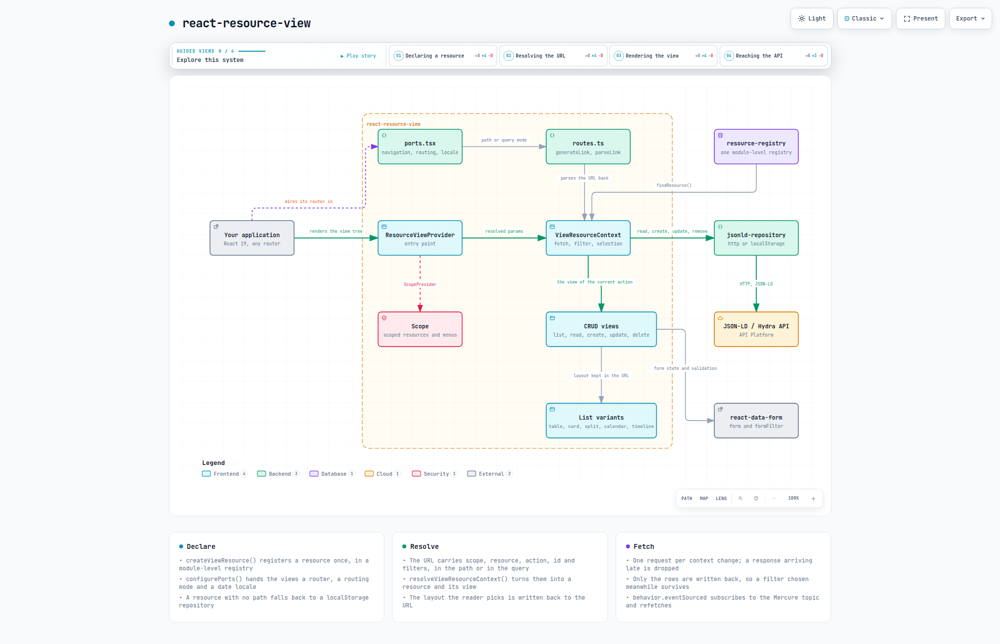

<p align="center">
  <a href="https://cardona.digital/react-resource-view/playground/">
    
  </a>
</p>

<p align="center">
  <a href="https://www.npmjs.com/package/react-resource-view"></a>
  <a href="https://github.com/SalvadorCardona/react-resource-view/blob/main/LICENSE"></a>
  <a href="https://cardona.digital/react-resource-view/"></a>
  <a href="https://cardona.digital/react-resource-view/playground/"></a>
</p>

# react-resource-view

**Documentation: [cardona.digital/react-resource-view](https://cardona.digital/react-resource-view/)**

CRUD views for REST APIs — API Platform, Spring Boot, Supabase, Strapi,
FastAPI, Django, or any REST API that publishes OpenAPI. You declare a resource — its
path, its form, its layout — and the package renders the list, the detail, the
create and edit forms, and the delete confirmation, wired to the API and to the
URL.

```tsx
import { createViewResource, ResourceView } from "react-resource-view"
import { tableViewOptionFactory } from "react-resource-view"

const articles = createViewResource("articles", {
  path: "/api/articles",
  name: "Articles",
  view: {
    form: { inputs: { title: { label: "Title" }, body: { label: "Body" } } },
    viewVariants: [tableViewOptionFactory()],
  },
})
```

Built on [`react-data-form`](https://github.com/SalvadorCardona/react-data-form)
for the forms. Which API answers, and how it spells a page or a filter, is a
[dialect](#connecting-an-api) — JSON-LD is the default, not a requirement.

Two libraries, one idea: `react-data-form` for the forms, `react-resource-view`
for the application around them.
[Watch the 1-minute tour](https://cardona.digital/react-resource-view/videos/two-libraries.mp4)
(with sound).

<p align="center">
  <a href="https://cardona.digital/react-resource-view/videos/two-libraries.mp4">
    
  </a>
</p>

## See it in action

A page builder declared as data: blocks on the left, the live page on the
right, and the JSON behind it. [Watch the full video (with sound)](https://cardona.digital/react-resource-view/videos/page-builder.mp4)
or [open the page builder](https://cardona.digital/react-resource-view/playground/builder/).

<p align="center">
  <a href="https://cardona.digital/react-resource-view/videos/page-builder.mp4">
    
  </a>
</p>

## Documentation

Everything below, at length and with the examples running rather than quoted:
[the documentation site](https://cardona.digital/react-resource-view/docs/resource-view/)
— a page per layout, per filter, per dialect — and a
[playground](https://cardona.digital/react-resource-view/playground/):
a whole back office built from eight resource declarations, every edit real,
every screen a URL, and the source of each screen one click away.

[](https://cardona.digital/react-resource-view/playground/)

## Architecture

[](https://cardona.digital/react-resource-view/architecture.html)

A resource is declared once and registered. The URL says which resource, which
action and which filters; the context resolves that into a view, fetches through
the resource's own repository, and renders. The package never talks to a router
itself, nor to one API in particular: the router arrives through
`configurePorts`, the API through `configureApi`.

The picture above is a still of an interactive diagram:
[open it](https://cardona.digital/react-resource-view/architecture.html)
to trace a relationship, focus a component, or follow the four guided views.

## Connecting an API

The views know a resource has rows, pages and filters. How a given backend
spells those — the URL an item lives at, the query string a filter becomes, the
envelope a collection arrives in, where the validation errors hide — is a
**dialect**, set once at startup:

```ts
import { configureApi, strapiDialect } from "react-resource-view"

configureApi({
  baseUrl: "https://cms.example.com",
  getAuthToken: () => (isLogged() ? getUserToken() : undefined),
  dialect: strapiDialect(),
})
```

| Dialect             | Backend               | What it knows                                                                                                                  |
| ------------------- | --------------------- | ------------------------------------------------------------------------------------------------------------------------------ |
| `jsonLdDialect()`   | API Platform, Hydra   | `member` / `totalItems`, IRIs, `page` and `itemsPerPage`, Hydra `violations`, Mercure, CSV export                              |
| `strapiDialect()`   | Strapi v4 and v5      | `pagination[page]`, `filters[field][$eq]`, `sort[0]`, `populate`, writes under `data`, `documentId`                            |
| `supabaseDialect()` | Supabase, PostgREST   | `limit` / `offset`, `field=eq.value`, `order`, the count in `Content-Range`, `Prefer: return=representation`                   |
| `fastapiDialect()`  | FastAPI               | `skip` / `limit` or `page` / `size`, plain query filters, `order_by=-field`, `{ items, total }`, 422 `detail`                  |
| `springDialect()`   | Spring Boot           | `page` (from 0) / `size`, `sort=field,desc`, `Page`, `PagedModel` or HAL `_embedded`, Bean Validation errors                   |
| `djangoDialect()`   | Django REST Framework | `page` / `page_size` or `limit` / `offset`, django-filter query filters, `ordering=-field`, `{ count, results }`, field errors |

JSON-LD is the default, so an application already talking to API Platform needs
none of this — and keeps going through the client it configured with
`configureClient` (see [The rest of the configuration](#the-rest-of-the-configuration)).

### Strapi

```ts
import { configureApi, strapiDialect, createViewResource } from "react-resource-view"

configureApi({
  baseUrl: "https://cms.example.com",
  getAuthToken: () => getApiToken(),
  dialect: strapiDialect(),
})

const articles = createViewResource("articles", {
  path: "articles", // → /api/articles
  name: "Articles",
  view: {
    form: { inputs: { title: { label: "Title" } } },
    itemsPerPage: 25,
  },
})
```

`strapiDialect` takes `apiPath` (default `/api`), `populate` (default `"*"` —
without it the relation columns come back empty), `identifier` (`documentId` on
v5, `id` on v4) and `defaultOperator` (`$eq`; pass `$containsi` to make every
text filter a case-insensitive search). The v4 `{ id, attributes }` envelope is
flattened on the way in, so a resource declared once reads the same on both
versions.

### Supabase

```ts
import {
  configureApi,
  supabaseDialect,
  createViewResource,
} from "react-resource-view"

configureApi({
  baseUrl: "https://xyzcompany.supabase.co",
  getAuthToken: () => getSession()?.access_token,
  dialect: supabaseDialect({ apiKey: import.meta.env.VITE_SUPABASE_ANON_KEY }),
})

const articles = createViewResource("articles", {
  path: "articles", // → /rest/v1/articles
  name: "Articles",
  view: { form: { inputs: { title: { label: "Title" } } } },
})
```

`supabaseDialect` takes `apiKey` (a value or a function), `primaryKey` (default
`id` — PostgREST addresses a row by a filter on it, having no item route),
`select` (default `*`; `"*,author(*)"` embeds a relation), `schema`,
`defaultTextOperator` and `restPath`.

### FastAPI

```ts
import {
  configureApi,
  fastapiDialect,
  createViewResource,
} from "react-resource-view"

configureApi({
  baseUrl: "https://api.example.com",
  getAuthToken: () => getAccessToken(),
  dialect: fastapiDialect(),
})

const items = createViewResource("items", {
  path: "items", // → /items, /items/{id}
  name: "Items",
  view: { form: { inputs: { title: { label: "Title" } } } },
})
```

`fastapiDialect` takes `primaryKey` (default `id`), `pagination`
(`"skip-limit"`, the default, or `"page-size"` for
[fastapi-pagination](https://github.com/uriyyo/fastapi-pagination)),
`defaultItemsPerPage` (default `30`), `orderParam` (default `order_by`, sent as
`-created_at,title`) and `trailingSlash` (default `false`; set it when the
collection route is declared as `/items/`, or FastAPI answers with a 307
redirect). A 422 lands under the field its `loc` names —
`["body", "address", "city"]` on the `address.city` input; a `detail` spelled
as a sentence becomes the error's explanation.

A route the dialect reads as it stands, as in the FastAPI tutorial — a bare
array carries no total, so the pagination hides itself:

```python
@app.get("/items", response_model=list[Item])
def list_items(skip: int = 0, limit: int = 30, order_by: str | None = None):
    return repository.list(offset=skip, limit=limit, order_by=order_by)

@app.get("/items/{item_id}", response_model=Item)
def read_item(item_id: int): ...

@app.post("/items", response_model=Item)
def create_item(item: ItemCreate): ...

@app.patch("/items/{item_id}", response_model=Item)
def update_item(item_id: int, item: ItemUpdate): ...

@app.delete("/items/{item_id}", status_code=204)
def delete_item(item_id: int): ...
```

With fastapi-pagination the list answers `{ items, total, page, size, pages }`,
and the pagination counts its pages from `total` — pass
`fastapiDialect({ pagination: "page-size" })`:

```python
from fastapi_pagination import Page, add_pagination, paginate

@app.get("/items", response_model=Page[Item])
def list_items():
    return paginate(repository.all())

add_pagination(app)
```

### Spring Boot

```ts
import { configureApi, springDialect, createViewResource } from "react-resource-view"

configureApi({
  baseUrl: "http://localhost:8080",
  getAuthToken: () => getAccessToken(),
  dialect: springDialect(),
})

const books = createViewResource("books", {
  path: "/api/books", // → /api/books?page=0&size=20, /api/books/{id}
  name: "Books",
  view: { form: { inputs: { title: { label: "Title" } } } },
})
```

A controller taking a `Pageable` and returning a `Page` needs nothing more: the
dialect reads `content` and `totalElements`, the `page` block of a `PagedModel`,
or Spring Data REST's `_embedded` — a record whose id is hidden is addressed
by its `_links.self.href`. `springDialect` takes `primaryKey` (default `id`),
`defaultItemsPerPage` (default `20`) and `updateMethod` (`"PUT"`, the default, or
`"PATCH"`). A failed `@Valid` lands each `errors[].field` on its input, and a
`ProblemDetail` gives the error its title and explanation.

### Django

```ts
import { configureApi, djangoDialect, createViewResource } from "react-resource-view"

configureApi({
  baseUrl: "http://localhost:8000",
  getAuthToken: () => getAccessToken(),
  dialect: djangoDialect(),
})

const articles = createViewResource("articles", {
  path: "/api/articles", // → /api/articles/?page=1&page_size=30, /api/articles/{id}/
  name: "Articles",
  view: { form: { inputs: { title: { label: "Title" } } } },
})
```

A `ModelViewSet` with a paginator answers `{ count, next, previous, results }`;
the dialect reads `results` and counts its pages from `count`. A view without
pagination answers a bare array, which carries no total, so the pagination hides
itself. `djangoDialect` takes `primaryKey` (default `id`), `pagination`
(`"page-number"`, the default, or `"limit-offset"` for
`LimitOffsetPagination`), `pageSizeParam` (default `page_size`, which DRF only
reads when the paginator sets `page_size_query_param`), `defaultItemsPerPage`
(default `30`), `orderParam` (default `ordering`, sent as `-created_at,title`)
and `trailingSlash` (default `true`, as DRF's routers declare it; Django
redirects the other spelling and the redirect loses the body of a POST). A 400
lands each message under its field — `{ address: { city: [...] } }` on
`address.city`, `non_field_errors` on the form — and a `detail` becomes the
explanation of the error. The schema comes from
[drf-spectacular](https://drf-spectacular.readthedocs.io) at
`/api/schema/?format=json`.

### Two backends at once

A resource may carry a dialect of its own, which wins over the configured one:

```ts
const invoices = createViewResource("invoices", {
  path: "invoices",
  dialect: supabaseDialect({ apiKey }),
})
```

### Filters, pages and sorts

They are written once, in the package's own vocabulary, and the dialect
translates them:

| Key                 | Means              | Strapi                 | Supabase          | FastAPI                     | Django                      |
| ------------------- | ------------------ | ---------------------- | ----------------- | --------------------------- | --------------------------- |
| `page`              | 1-based page       | `pagination[page]`     | `offset`          | `skip` (or `page`)          | `page`                      |
| `itemsPerPage`      | rows per page      | `pagination[pageSize]` | `limit`           | `limit` (or `size`)         | `page_size` (or `limit`)    |
| `order`             | `{ title: "asc" }` | `sort[0]=title:asc`    | `order=title.asc` | `order_by=title` (`-title`) | `ordering=title` (`-title`) |
| `title: "hello"`    | a field            | `filters[title][$eq]`  | `title=eq.hello`  | `title=hello`               | `title=hello`               |
| `status: ["a","b"]` | any of             | `filters[status][$in]` | `status=in.(a,b)` | `status=a&status=b`         | `status=a&status=b`         |

A value spelled as an object carries its own operator through untouched —
`{ title: { $containsi: "hell" } }` on Strapi, `{ createdAt: { gte: "2024-01-01" } }`
on Supabase.

### Another API entirely

A dialect is one object — `buildRequest`, `readCollection`, `readItem`,
`getId`, `getIdentifier`, `normalizeError` — and `ApiDialectInterface` is
exported to implement it. A resource that brings its own `getCollection`,
`getItem` and the rest still bypasses all of this, as it always could.

### Typing resources from OpenAPI

Rather than copying the API's types into hand-written interfaces, export the
OpenAPI schema your API publishes (`/api/docs.jsonopenapi` on API Platform,
`/openapi.json` on FastAPI, where the Pydantic models become
`components["schemas"]`), and generate the types with
[api-dumper](https://github.com/SalvadorCardona/api-dumper):

```bash
pnpm add -D api-dumper typescript
```

```ts
// api-dumper.config.ts
import { defineConfig } from "api-dumper"

export default defineConfig({
  source: "http://localhost/api/docs.jsonopenapi",
  outDir: "src/api-schema",
  preset: "api-platform", // only on API Platform
  strip: { contentTypes: ["text/csv"] },
})
```

`npx api-dumper` writes `openapi.json`, `api-schema.ts` and one file per enum under
`enums/`, all to commit; `npx api-dumper --check` fails the CI when they are out of
date.

`paths` types the client, `components["schemas"]` types the resources:

```ts
import type { components } from "./src/api-schema/api-schema"

// API Platform's JSON-LD schema carries the "@id" an item needs; on another
// backend, intersect the schema with { "@id": string }.
type Article = components["schemas"]["Article.jsonld"]

const articles = createViewResource<Article>("articles", {
  path: "/api/articles",
  view: { form: { inputs: { title: { label: "Title" } } } },
})
```

The whole recipe — the config, the enums, the per-backend
specifics for API Platform, Strapi, Supabase, FastAPI and Django, and when to regenerate — is on
[the documentation site](https://cardona.digital/react-resource-view/docs/resource-view/openapi-types/).

## Start a project

One command writes a whole back office on your API — Vite, React, Tailwind,
TanStack Router, the admin layout and one example resource — and asks for the
rest:

```bash
npx react-resource-view init my-admin
```

It asks which API the back office talks to — API Platform, Spring Boot,
another REST API, Supabase, Strapi, FastAPI or Django — its URL, and the URL of its
OpenAPI schema, guessed from the backend (`/api/docs.jsonopenapi`,
`/v3/api-docs`, `/openapi.json`, `/api/schema/?format=json`). The dialect is wired in `src/setup.ts`, the URL
lands in `.env`, and the project comes with the commands that dump the schema
into TypeScript with [api-dumper](https://github.com/SalvadorCardona/api-dumper):

```bash
npm run api-schema         # or: make api-schema — writes src/api-schema/
npm run api-schema:check   # in the CI: fails when src/api-schema is stale
```

One starter per technology, ready to paste:

| Backend        | Command                                                                           | Schema dumped from         |
| -------------- | --------------------------------------------------------------------------------- | -------------------------- |
| API Platform   | `npx react-resource-view init my-admin -b api-platform -u https://localhost`      | `/api/docs.jsonopenapi`    |
| Spring Boot    | `npx react-resource-view init my-admin -b spring-boot -u http://localhost:8080`   | `/v3/api-docs`             |
| Other REST API | `npx react-resource-view init my-admin -b rest -u http://localhost:3000 -s <url>` | the URL you pass           |
| Supabase       | `npx react-resource-view init my-admin -b supabase -u https://<ref>.supabase.co`  | `supabase gen types`       |
| Strapi         | `npx react-resource-view init my-admin -b strapi -u http://localhost:1337`        | `/api/openapi.json`        |
| FastAPI        | `npx react-resource-view init my-admin -b fastapi -u http://localhost:8000`       | `/openapi.json`            |
| Django         | `npx react-resource-view init my-admin -b django -u http://localhost:8000`        | `/api/schema/?format=json` |

Every question has a flag — `--backend spring-boot --api-url http://localhost:8080
--schema-url … --yes` — see `npx react-resource-view init --help` and
[the starter page](https://cardona.digital/react-resource-view/docs/resource-view/starter/).
Writing your API in Python? [FastAPI and Django side by side](https://cardona.digital/react-resource-view/docs/resource-view/python/).

## Installation

```bash
pnpm add react-resource-view react-data-form react-mini-i18n resource-registry
```

`react`, `react-data-form`, `react-mini-i18n` and `resource-registry` are peer
dependencies. The last two own module-level singletons — a dictionary and a
registry — so they must resolve to a single copy.

### Styles

The components use [Tailwind CSS v4](https://tailwindcss.com) classes backed by
the shadcn theme variables. Tailwind must scan the compiled files:

```css
@import "tailwindcss";
@source "../node_modules/react-resource-view/dist";

/* Only if your application has no shadcn theme of its own */
@import "react-resource-view/styles.css";
```

## Connecting a router

The views navigate and build links, but the package knows no router. It asks
for four primitives, and ships an adapter for
[TanStack Router](https://tanstack.com/router):

```ts
import { configurePorts } from "react-resource-view"
import { tanstackAdapter } from "react-resource-view/tanstack"

configurePorts({ navigation: tanstackAdapter })
```

With any other router, supply the four yourself:

```ts
configurePorts({
  navigation: {
    useNavigate: () => { /* ({ to, replace, resetScroll }) => void */ },
    useLocation: () => ({ pathname, searchStr }),
    Link: ({ to, children, ...rest }) => <RouterLink to={to} {...rest}>{children}</RouterLink>,
    Navigate: ({ to, replace }) => <RouterRedirect to={to} replace={replace} />,
  },
})
```

Left unconfigured, navigation falls back to full page loads through the History
API. Enough for a test or a story, not for production.

Importing `react-resource-view/tanstack` is what pulls TanStack Router in — the
core never references it, so an application on another router installs nothing
extra.

## The rest of the configuration

```ts
configurePorts({
  appName: "My application", // page title suffix
  description: "…", // page metadata
  appUrl: "https://app.example.com", // absolute links escaping an iframe
  isDev: import.meta.env.DEV, // development affordances
})
```

The API connection is configured separately, through
[`configureApi`](#connecting-an-api). On the JSON-LD dialect it can also come
from the client itself, which is what an existing API Platform application
already does:

```ts
import { configureClient } from "jsonld-api-client"

configureClient({
  baseUrl: "https://api.example.com",
  getAuthToken: () => (isLogged() ? getUserToken() : undefined),
  getScope: () => getCurrentScope(),
})
```

`configureApi` falls back to those settings when it is given none of its own,
so nothing has to move.

## Admin layout

A scope's `decoratorComponent` wraps every view of that scope. `AdminLayout` is
a ready-made one — a collapsible sidebar built from the scope's `menu`, a top
bar with a breadcrumb, a page header naming the record on screen, and a bottom
bar instead of the sidebar on a phone:

```ts
const adminScope: ScopeInterface = {
  name: "admin",
  label: "Back office",
  decoratorComponent: createAdminLayout({ logo: <MyLogo />, topBarEnd: <UserMenu /> }),
  menu: [createItemMenuWithResource({ resource: tasks })],
}
```

Links kept out of the way of the pages — help, support, documentation — are
pinned at the bottom of the sidebar with `footerMenu` (an absolute `href` opens
in a new tab), or any node with `sidebarFooter`; on a phone they go behind a
last entry of the bottom bar:

```ts
createAdminLayout({
  footerMenuTitle: "Need help?",
  footerMenu: [{ name: "Documentation", href: "https://example.com/docs" }],
})
```

Views sit in a column of constrained width; a board, a calendar or a wide table
takes the whole page with `fullWidth` — on the resource's `view`, on one action
of `views`, or on a single list variant, the most specific one winning:

```ts
createViewResource("tasks", {
  view: {
    fullWidth: true,
    viewVariants: [
      columnViewOptionFactory({ name: "Board", identifierKey: "status" }),
    ],
  },
  // The forms keep the column.
  views: { [ActionList.update]: { fullWidth: false } },
})
```

[The admin layout
page](https://cardona.digital/react-resource-view/docs/resource-view/admin-layout/)
goes through the navigation, the slots and the theme; the
[playground](https://cardona.digital/react-resource-view/playground/?view=admin/admin_tasks/list)
runs on it, its task board full width.

## Layouts

A list renders through one of several variants, chosen with a factory:

| Factory                     | Layout                                 |
| --------------------------- | -------------------------------------- |
| `tableViewOptionFactory`    | Data table, editable in place          |
| `cardViewOptionFactory`     | Card grid                              |
| `columnViewOptionFactory`   | Columns, grouped by a key              |
| `splitViewFactory`          | List on the left, details on the right |
| `calendarViewOptionFactory` | Calendar, by day or week               |
| `timelineViewOptionFactory` | Timeline, grouped by row               |
| `itemViewOptionFactory`     | Plain item list                        |

Several variants can coexist on one resource; the view keeps the reader's
choice in the URL.

### Boards: opening, selecting, moving

A card of a `columnViewOptionFactory` board opens the record when the view says
where, and several cards move together:

```tsx
columnViewOptionFactory({
  identifierKey: "status",
  identifierKeyList: STATUSES,
  behavior: {
    // "drawer" | "popup" | "window"; unset, a card opens nothing.
    openRecordIn: "drawer",
    // On by default.
    selectable: true,
    // Beside "Move to…", in the bar a selection brings up.
    bulkActions: [{ label: "Archive", onAction: (records) => archive(records) }],
  },
})
```

- **Opening** — the whole card is clickable and reachable with Tab, Enter opens
  it. `drawer` and `popup` show the record's `read` view over the board, with a
  way to edit it, and write it into the URL as a child view
  (`…/tasks/list/tasks/read/12`): the link can be shared and Back closes it.
  `window` goes to the record's page through `generateLink`.
- **Controls first** — a button, a link, a menu, a checkbox or a drag handle in
  the card keeps its click (or anything marked `data-card-control`); selecting
  text does not open the card either.
- **Selecting** — the checkbox on hover, Ctrl/Cmd+click, Shift+click for a range
  in a column, a long press on a phone; Escape clears it.
- **Moving** — drag a selected card to carry the whole selection, or use
  “Move to…”. One update per record through the repository, drawn at once; a
  card whose update fails goes back to its column, and a message says how many.

### A layout of your own

A variant is a `createView` call over three components, so the eighth layout is
a single file — and one command writes it:

```bash
npx react-resource-view create-view-variant Heatmap --dir src/views
```

Run it bare and it asks for the name and the directory. It writes
`src/views/heatmapViewFactory.tsx`: the list, row and item components, the
factory that declares them, and the options interface to extend. Nothing is
registered anywhere — declare the factory in `viewVariants` beside the built-in
ones:

```ts
import heatmapViewFactory from "./views/heatmapViewFactory"

view: {
  viewVariants: [tableViewOptionFactory(), heatmapViewFactory()],
}
```

`--icon <LucideIcon>` picks the switcher's icon, `--jsx` writes JavaScript,
`--dry-run` prints the file instead of writing it, and `--yes` never asks — see
`npx react-resource-view --help`. [Create your own view
variant](https://cardona.digital/react-resource-view/docs/resource-view/custom-variant/)
takes the generated file apart, and runs one.

## Filters

`formFilter` declares the filter form, and `defaultFilter` the filters applied
as long as the URL carries none of its own. Both are written in the package's
own vocabulary; the [dialect](#filters-pages-and-sorts) translates them for the
API:

```ts
view: {
  formFilter: { inputs: { published: { label: "Published" } } },
  defaultFilter: { published: true },
}
```

The distinction matters: a `defaultValue` on a filter input would not do, since
the first request goes out before the form exists — the list would then show
something other than what the filters display.

## Development

```bash
pnpm install
pnpm test
pnpm typecheck
pnpm lint
pnpm build
```

### The architecture diagram

The diagram is generated by [archify](https://github.com/tt-a1i/archify) from
`diagrams/react-resource-view.architecture.json`. The renderer is installed
rather than vendored; `skills-lock.json` records the version it came from:

```bash
npx skills add tt-a1i/archify --skill archify --agent claude-code --copy
ARCHIFY=.claude/skills/archify/bin/archify.mjs

# Rebuild the interactive artefact the documentation site serves
node $ARCHIFY deliver architecture \
  diagrams/react-resource-view.architecture.json \
  website/public/architecture.html --quality showcase

# Recapture the still the README shows, and keep the 2048x1320 light one
node $ARCHIFY visual-check website/public/architecture.html
cp website/public/architecture.visual-check.2048x1320.light.png \
  diagrams/react-resource-view.png
rm website/public/architecture.visual-check.*
```

`deliver` refuses to write an artefact that fails its own layout and
composition checks, so a diagram that lands is a diagram that reads.

## Author

Written and maintained by Salvador Cardona — full-stack web developer. The rest
of his work, and how to reach him, is on [cardona.digital](https://cardona.digital).

## License

MIT
